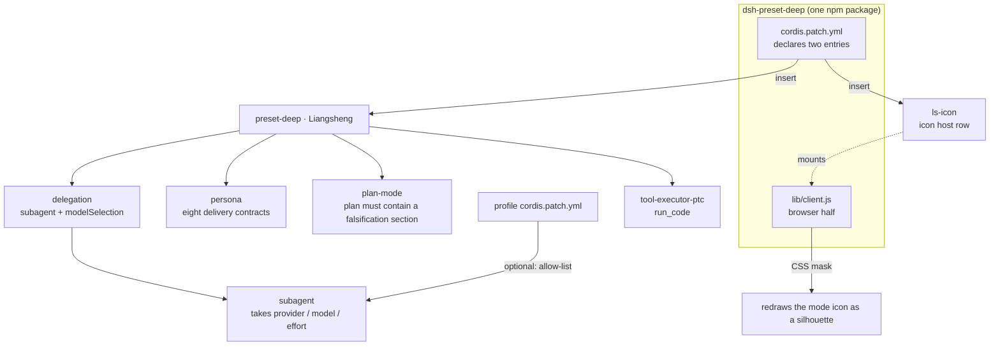

# Liangsheng Mode · dsh-preset-deep

[中文](README.md) | [English](README.en.md)

> A fifth work mode for **DeepSeek Harness**: **falsify first, deliver second.**

The four built-in modes (standard / ptc / minimal / cordis) answer "which tools may I call". None of them answers the more common question: **when are you allowed to conclude anything?**

Liangsheng Mode writes that standard into the persona and plan-mode instead of leaving it to per-conversation negotiation. It does not make you faster — it makes you **unable to bluff**.


## Core capabilities

Eight hard constraints, each aimed at one recurring failure:

| # | Capability | Failure it blocks |
|---|---|---|
| 1 | **Four opening questions** — what would an expert in this line do that wasn't asked, what primary material would they start from, what concrete method would they use, what external evidence decides correctness | Coding first, discovering the direction was wrong later |
| 2 | **Know when to stop** — write the completion condition (a command or an assertion) before starting; stop and report the blocker after two failures on the same path | Endless retries, pretending to be done |
| 3 | **Three-way sourcing** — tag every fact `[file]` / `[search]` / `[memory]`; `[memory]` never enters a conclusion | Treating impressions as evidence |
| 4 | **Compute, don't estimate** — math, dates, boundaries and set operations are verified by running code | Numbers invented by mental arithmetic |
| 5 | **Allowed to not know** — mark `[unknown]` and state what is missing | Wrapping uncertainty in "maybe / probably" |
| 6 | **Decompose reasoning** — split complex inference into independently decidable propositions, judge each, then assemble | A long, plausible-looking chain with nothing testable in it |
| 7 | **Cross-validation** — send uncertain claims to 2–3 subagents; before delivering an important conclusion, send a reviewer subagent that never saw this context | Self-confirmation, echo chambers |
| 8 | **Spend compute by difficulty** — mechanical work goes to free-model subagents, judgement stays with you; effort follows difficulty | Paying top-tier rates to copy a file |

## Architecture



Three things worth noticing:

1. **One package, two halves**: `cordis.patch.yml` declares the preset and the icon host row; `lib/client.js` runs in the browser and never touches the host.
2. **Switching subagent models needs one more thing**: the preset only turns on `modelSelection`; the authorization comes from `subagent-model-selection-settings` in the profile layer (below).
3. **The icon is a client patch, not configuration**: DSH presets have no `icon` field — the glyph is a hard-coded svg, so the client half locates it by label text and masks it.

## Difference from PTC

|  | PTC | Liangsheng |
|---|---|---|
| Plan | Decision-complete | **Must include a falsification section**: at least two pieces of evidence that could disprove it, and how to obtain them |
| Conclusion | No required format | **Must be tagged `[verified]` / `[inferred]` / `[unknown]`**; untagged claims are not conclusions |
| Arithmetic | Mental math allowed | **Verify by running code** |
| Blast radius | Task-scoped | **Touch only the named files**, end with `git diff --stat` |

## Install

**npm**

```bash
dsh plugin add dsh-preset-deep
```

**Manual**

```bash
# 1. copy into the profile's node_modules
cp -r dsh-preset-deep ~/.dsh/profiles/<profile>/node_modules/
# 2. append "dsh-preset-deep" to dsh.profile.bundles in the profile's package.json
# 3. restart the harness
```

> Remove any hand-written `preset-deep` block from the profile's `cordis.patch.yml` first, or the two collide.

## Running subagents on other models

This is what separates it from the four built-in modes: **mechanical work can go to a cheap model while judgement stays with you.**

The preset's `subagent` row enables `modelSelection` and `modelDiscovery`, so a subagent may take `provider` / `model` / `reasoning_effort`. But the harness enforces one rule:

> Without a session-level allow-list, a subagent may only use the parent session's own route.

That is the real reason the other modes cannot fan out to other models — the official presets also set `modelSelection: true`, but never ship an allow-list. Append to the profile's `cordis.patch.yml`:

```yaml
- id: subagent-model-selection-settings
  name: '@deepseek-ai/dsh-tool-subagent/model-selection-settings'
  config:
    enabled: true
    allowedModels:
      - { provider: deepseek-account, model: deepseek-flash }
      - { provider: <your free provider>, model: <model id> }
```

Without it, naming another route fails with `child LLM route "<p>/<m>" is not allowed for this Session`.

## Icon

- Located by **label text** (`LABEL` at the top of `lib/client.js`), not by class name — DSH's class names are build hashes and change on upgrade.
- The mask paints with `currentColor`, so it follows light and dark themes.
- Replace the image by swapping `assets/icon.png` and re-encoding it into `lib/client.js`; resize with `ICON_SIZE`.

## Known limitations

- **Renaming requires syncing**: `LABEL` must equal the preset's `config.name`.
- **The icon overflows**: a 34px icon inside a 22px-tall label, kept visible by `[data-ls-icon]{overflow:visible}`; drop `ICON_SIZE` to 28px if it collides.
- **With billion-context installed**, add an ordering fence after the preset row:
  ```yaml
  - id: preset-deep
    inject: [biliBasicCompactionPolicy]
  ```
- Tested on harness runtime `0.2.1-rc.5` (desktop `0.2.2-rc.1`).

## License

Dual-licensed under **MIT** or **Apache-2.0**, at your option.

The preset structure derives from the harness's own `ptc` preset (MIT).
