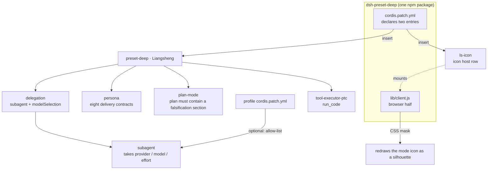

# Liangsheng Mode · dsh-preset-deep

[中文](README.md) | [English](README.en.md)

> A fifth work mode for **DeepSeek Harness**: **falsify first, deliver second.**

The four built-in modes (standard / ptc / minimal / cordis) answer "which tools may I call". None of them answers the more common question: **when are you allowed to conclude anything?**

Liangsheng Mode writes that standard into the persona and plan-mode instead of leaving it to per-conversation negotiation. It does not make you faster — it makes you **unable to bluff**.


## Core capabilities

Eight hard constraints, each aimed at one recurring failure:

| # | Capability | Failure it blocks |
|---|---|---|
| 1 | **Four opening questions** — what would an expert in this line do that wasn't asked, what primary material would they start from, what concrete method would they use, what external evidence decides correctness | Coding first, discovering the direction was wrong later |
| 2 | **Know when to stop** — write the completion condition (a command or an assertion) before starting; stop and report the blocker after two failures on the same path | Endless retries, pretending to be done |
| 3 | **Three-way sourcing** — tag every fact `[file]` / `[search]` / `[memory]`; `[memory]` never enters a conclusion | Treating impressions as evidence |
| 4 | **Compute, don't estimate** — math, dates, boundaries and set operations are verified by running code | Numbers invented by mental arithmetic |
| 5 | **Allowed to not know** — mark `[unknown]` and state what is missing | Wrapping uncertainty in "maybe / probably" |
| 6 | **Decompose reasoning** — split complex inference into independently decidable propositions, judge each, then assemble | A long, plausible-looking chain with nothing testable in it |
| 7 | **Cross-validation (on request)** — for claims you cannot pin down, re-check from another angle yourself first; only when you explicitly ask does it send 2–3 subagents to answer independently, and before delivery it sends a reviewer that never saw the context — again, only on request | A self-confirming conclusion nobody attacked from the other side |
| 8 | **Subagents: visible, never proactive** — it can list the routes this machine allows (`list_subagent_models`, a read-only query) but delegates nothing unless you ask; when it does, it picks by "available → cheapest → good enough" and switches after two consecutive failures on one route | Outsourcing judgement to save tokens, or grinding alone when delegation was asked for |

## Architecture



Three things worth noticing:

1. **One package, two halves**: `cordis.patch.yml` declares the preset and the icon host row; `lib/client.js` runs in the browser and never touches the host.
2. **Switching subagent models needs one more thing**: the preset only turns on `modelSelection`; the authorization comes from `subagent-model-selection-settings` in the profile layer (below).
3. **The icon is a client patch, not configuration**: DSH presets have no `icon` field — the glyph is a hard-coded svg, so the client half locates it by label text and masks it.

## Difference from PTC

|  | PTC | Liangsheng |
|---|---|---|
| Plan | Decision-complete | **Must include a falsification section**: at least two pieces of evidence that could disprove it, and how to obtain them |
| Conclusion | No required format | **Must be tagged `[verified]` / `[inferred]` / `[unknown]`**; untagged claims are not conclusions |
| Arithmetic | Mental math allowed | **Verify by running code** |
| Blast radius | Task-scoped | **Touch only the named files**, end with `git diff --stat` |

## Install

**Manual (the main path until the npm release)**

```bash
# 1. copy into the profile's node_modules
cp -r dsh-preset-deep ~/.dsh/profiles/<profile>/node_modules/
# 2. append "dsh-preset-deep" to dsh.profile.bundles in the profile's package.json
# 3. restart the harness
```

> Back up the profile's `package.json` and `cordis.patch.yml` before editing them — DSH replaces both files wholesale, it does not merge them.

**From the release tarball** (if you would rather not clone)

```bash
# <version> follows package.json / the Release page (currently 0.1.2)
tar -xzf dsh-preset-deep-<version>.tgz -C ~/.dsh/profiles/<profile>/node_modules/
mv ~/.dsh/profiles/<profile>/node_modules/package ~/.dsh/profiles/<profile>/node_modules/dsh-preset-deep
# then add "dsh-preset-deep" to dsh.profile.bundles and restart
```

**npm (not published yet)**

> This package is not on npm yet, so `dsh plugin add dsh-preset-deep` will fail. This section takes effect once it is published.

> Remove any hand-written `preset-deep` block from the profile's `cordis.patch.yml` first, or the two collide. Remove only the full preset definition; if you added an `inject:` ordering fence on `- id: preset-deep` (see Known limitations), keep that row.

## Adapt the persona to your machine

The persona lives in the `persona` row of `cordis.patch.yml`, and the published version **names no provider and no model**. To tighten it, rewrite that row — pin your preferred model, or make your own install delegate to free models automatically — then run `node scripts/validate.cjs`, which blocks regressions such as hard-coding someone else's provider.

## Examples

| File | What it is |
|---|---|
| [`examples/allow-list.patch.yml`](examples/allow-list.patch.yml) | Fill-in template for the subagent allow-list, paste into the profile's `cordis.patch.yml` |
| [`examples/acceptance.md`](examples/acceptance.md) | Five-minute acceptance run: four test prompts, the pass line, four failure signatures |

## Subagents

**Visible, but never proactive.**

- The preset's `subagent` row enables `modelSelection` + `modelDiscovery`, so `list_subagent_models` can always list the routes this machine allows — a read-only query, not delegation.
- The persona is explicit: **unless you ask for a subagent, none is spawned.** It will not outsource judgement to save tokens, and it will not fan out subagents for cross-validation on its own.
- To delegate, just say so: "spawn a subagent for X using `<provider>/<model>`". It picks one by "available → cheapest → good enough" and switches after two consecutive failures on the same route instead of retrying it.
- To cross-validate: "send 2–3 subagents to answer this independently"; before an important delivery, add "send a reviewer subagent that never saw this context".

### Allow-list: the prerequisite for non-parent routes

> Without a session-level allow-list, a subagent may only use the parent session's own route.

That is the real reason other modes cannot reach other models — the official presets do write `modelSelection: true`, but none of them ever configures an allow-list. Append to the profile's `cordis.patch.yml`:

```yaml
- id: subagent-model-selection-settings
  name: '@deepseek-ai/dsh-tool-subagent/model-selection-settings'
  config:
    enabled: true
    allowedModels:
      - { provider: deepseek-account, model: deepseek-flash }
      - { provider: <your-free-provider>, model: <model-id> }
```

Without it, asking for another route fails with `child LLM route "<p>/<m>" is not allowed for this Session`. A fill-in template ships as [`examples/allow-list.patch.yml`](examples/allow-list.patch.yml).

## Icon

- Located by **label text** (`LABEL` at the top of `lib/client.js`), not by class name — DSH's class names are build hashes and change on upgrade.
- The primary match is "the container's trimmed text equals `LABEL`"; if DSH ever swaps the icon implementation, `aria-label` / `title` are the fallback (they work even when the svg sits in a child node).
- Debug with `window.__LS_ICON_STATUS__` in the console: `{plugin, label, size, tagged, at}`. `tagged: 0` means nothing matched.
- The mask paints with `currentColor`, so it follows light and dark themes.
- Replace the image by swapping `assets/icon.png` and re-encoding it into `lib/client.js`; resize with `ICON_SIZE`.

## Development

```bash
npm install          # js-yaml only — the validator needs it to parse the !!js tag
npm test             # 44 structural assertions + 12 icon assertions
```

`scripts/validate.cjs` catches the regressions that matter: the preset rows or their order changed, a promise disappeared from the persona, someone hard-coded a foreign provider, `modelSelection` got turned off, `LABEL` drifted from `config.name`, or `package.json` grew an `engines.dsh`. CI: `.github/workflows/validate.yml` runs the same two commands on every push and PR. If the push token lacks `workflow` scope, GitHub refuses that file over the API — push it with a scoped token instead; `ci/validate.yml` keeps the same config for local or third-party CI.

## Known limitations

- **Renaming means syncing four code places plus one doc**: `config.name` in `cordis.patch.yml`, `LABEL` in `lib/client.js`, the registration id in `lib/client.js` (`__ModuleLoader__.load({ id: "dsh-preset-deep" })`), and `name` in `package.json`; the screenshot caption in the README too. If the first two disagree the icon silently does not appear (`validate.cjs` catches it); if the last two disagree the browser half never loads.
- **The icon overflows**: a 34px icon inside a 22px-tall label, kept visible by `[data-ls-icon]{overflow:visible}`; drop `ICON_SIZE` to 28px if it collides.
- **With billion-context installed**, add an ordering fence after the preset row:
  ```yaml
  - id: preset-deep
    inject: [biliBasicCompactionPolicy]
  ```
- Tested on harness runtime `0.2.2-rc.1` (same desktop version).

## Icon scan cost

Measured on a synthetic jsdom DOM (about 5000 svg nodes), Node `v26.12.1`, same machine:

| Metric | This run | Notes |
|---|---|---|
| Build DOM | 71.9 ms | fixture cost, not plugin cost |
| One `sync()` evaluation | 0.061 ms | selector + text comparison |
| One `apply()` | 37.0 ms | first run includes style injection and tagging |
| 10 consecutive rounds | 33.8 ms/round | stable value after MutationObserver coalescing |

Wall-clock measurements; reruns on the same machine vary by 20–30%. For real-page numbers, measure 60 seconds in the DevTools Performance panel before quoting.

## Version compatibility

**No version gate — deliberately.**

`package.json` declares neither `engines.dsh` nor `@deepseek-ai/dsh*` `peerDependencies`. DSH decides compatibility in this order: if `engines.dsh` exists it decides alone, otherwise every `dsh` peer is checked; with neither present there is nothing to evaluate, so the bundle is **never judged incompatible and never skipped wholesale**. That is the widest installable range.

**Functional floor: `0.2.2-alpha.2`.**

That is the first version whose `@deepseek-ai/dsh-web-app` `ptc` preset ships `tool-executor-ptc` and the new `modelSelection` / `modelDiscovery` keys; `0.2.1-rc.2` still used the old `modelSelectionSettings` key and had no PTC executor. All 23 rows resolve by package name, so renaming any of them breaks the install; `tool-executor-ptc` sets the functional floor — only the official `ptc` preset from 0.2.2-alpha.2 onward ships it.

| Version | Result |
|---|---|
| `0.2.2-rc.1` (tested on desktop) | ✅ Everything passes: mount, icon, subagent routing |
| `0.2.2-alpha.2` — `0.2.2-rc.1` | ⚠️ Partially tested (alpha.2: profile composition, web boot and client bundle load + style injection all pass; the start page has no preset switcher, so icon tagging was not triggered. rc.1 is the daily driver) |
| `≤ 0.2.1` | ⚠️ The bundle still loads, but `tool-executor-ptc` cannot be resolved and the mode card may show as broken |

This repo's `cordis.patch.yml` is derived from the official `0.2.2-rc.1` `presets/ptc.patch.yml`: two delegation rows removed, persona and plan-mode replaced.

**One deliberate difference from upstream**: the persona does not interpolate `{{model}}` (upstream uses that placeholder). `validate.cjs` therefore forbids `{{` in the persona — a choice, not a bug; switching to the template form means relaxing that assertion too.

To force an install on another version, grant an **exact-version** exemption in the profile's `compatibility.json` — an unmet gate skips the whole bundle rather than degrading it.

## License

Dual-licensed under **MIT** or **Apache-2.0**, at your option.

The preset structure derives from the harness's own `ptc` preset (MIT).
