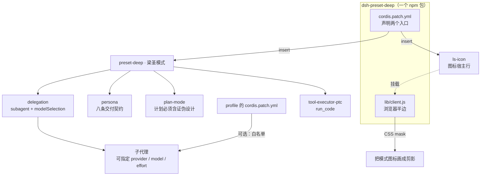

# 梁圣模式 · dsh-preset-deep

[中文](README.md) | [English](README.en.md)

> 给 **DeepSeek Harness** 加第五个工作模式：**先证伪，再交付**。

Harness 自带的四个模式（standard / ptc / minimal / cordis）解决的是"能调哪些工具"。它们没有回答一个更常见的问题：**你什么时候才允许下结论。**

梁圣模式把这套标准写进 persona 与 plan-mode，而不是留给每次对话的口头约定。它不让你更快，它让你**不能糊弄**。


## 核心能力

这八条是硬约束，不是建议。它们逐条对应一类最常见的失败：

| # | 能力 | 拦住的失败 |
|---|---|---|
| 1 | **开工四问** — 专家会做哪些没被要求的事、从什么一手材料入手、用什么具体方法、谁来判定对错 | 一上来就写代码，做完才发现方向错了 |
| 2 | **知止** — 开工先写完成条件（命令或断言），同一路径两次失败才停下报卡点 | 无限试错、假装完成 |
| 3 | **来源三分** — 每个事实标 `[文件]` / `[检索]` / `[记忆]`，`[记忆]` 不得进结论 | 把印象当证据 |
| 4 | **能算不算** — 数学、日期、边界、集合运算一律写代码验 | 心算造出的错误数字 |
| 5 | **允许不知道** — 拿不准标 `[未知]` 并写明缺什么 | 用"可能/大概"把不确定包装成结论 |
| 6 | **推理拆解** — 复杂推理拆成可独立判真假的小命题，逐个判再组装 | 一大段看起来严密、其实没有可检验环节的推断 |
| 7 | **交叉验证** — 拿不准的断言派 2–3 个子代理独立作答；重要结论交付前派一个**不带本次上下文**的复核者 | 自证自话、回音室 |
| 8 | **算力按难度分配** — 机械活派给免费模型子代理，判断活自己做；effort 跟难度走 | 用最贵的模型抄格式 |

## 架构



三件事值得注意：

1. **一个包，两个半边**：`cordis.patch.yml` 声明 preset 与图标宿主行；`lib/client.js` 是浏览器侧，不经过宿主。
2. **子代理要能换模型，还差一条白名单**：preset 只负责打开 `modelSelection`，真正授权来自 profile 层的 `subagent-model-selection-settings`（见下）。
3. **图标是客户端补丁，不是配置**：DSH 的 preset 没有 `icon` 字段，图标是写死的 svg，只能由客户端半边按文字定位后遮罩替换。

## 与 PTC 的差别

|  | PTC | 梁圣模式 |
|---|---|---|
| 计划 | 决策完整即可 | **必须含「证伪设计」**：至少两条能推翻自己的证据，并说明怎么取得 |
| 结论 | 无强制格式 | **必须标 `[实]` / `[推]` / `[未知]`**，标不出的不得进结论 |
| 计算 | 可以心算 | **能算的不许估** |
| 改动范围 | 按任务 | **只碰被点名的文件**，收尾贴 `git diff --stat` |

## 安装

**手动（当前唯一可用路径）**

```bash
# 1. 复制到 profile 的 node_modules
cp -r dsh-preset-deep ~/.dsh/profiles/<profile>/node_modules/
# 2. profile 的 package.json 里，dsh.profile.bundles 末尾加 "dsh-preset-deep"
# 3. 重启 Harness
```

**npm（尚未发布）**

> 这个包还没发到 npm，`dsh plugin add dsh-preset-deep` 现在会失败。发布后本条即生效。

> 装之前先删掉 profile 的 `cordis.patch.yml` 里手写的那段 `preset-deep`，否则同名冲突。

## 让子代理跑在别的模型上

这是本模式区别于前四个模式的关键：**机械活可以派给便宜模型，判断活留给自己。**

preset 里的 `subagent` 行已经开了 `modelSelection` 与 `modelDiscovery`，所以子代理可以指定 `provider` / `model` / `reasoning_effort`。但 Harness 有一条安全约束：

> 没有会话级白名单时，子代理只能使用父会话同一条路由。

这就是"别的模式派不动别的模型"的真实原因——官方 preset 其实也写了 `modelSelection: true`，但从来没有配过白名单。在 profile 的 `cordis.patch.yml` 追加：

```yaml
- id: subagent-model-selection-settings
  name: '@deepseek-ai/dsh-tool-subagent/model-selection-settings'
  config:
    enabled: true
    allowedModels:
      - { provider: deepseek-account, model: deepseek-flash }
      - { provider: <你的 free provider>, model: <模型 id> }
```

不配的话，显式指定别的路由会直接报 `child LLM route "<p>/<m>" is not allowed for this Session`。

## 图标

- 定位靠**文字**（`lib/client.js` 顶部的 `LABEL`），不是类名——DSH 的类名是构建哈希，升级就变。
- 遮罩用 `currentColor`，深浅主题自动跟随。
- 换图：替换 `assets/icon.png` 并重新编码进 `lib/client.js`；改大小：改 `ICON_SIZE`。

## 已知限制

- **改名要同步**：`LABEL` 必须等于 preset 的 `config.name`，否则图标不出现。
- **图标会溢出**：34px 图标放在 22px 高的标签里，靠 `[data-ls-icon]{overflow:visible}` 接住；挡住相邻元素就把 `ICON_SIZE` 降到 28px。
- **装了 billion-context 的话**：在 preset 行后补一条顺序栅栏：
  ```yaml
  - id: preset-deep
    inject: [biliBasicCompactionPolicy]
  ```
- 测试环境：Harness 运行时 `0.2.1-rc.5`（桌面版 `0.2.2-rc.1`）。

## 许可证

双许可：**MIT** 或 **Apache-2.0**，任选其一。

preset 结构派生自 Harness 官方 `ptc` preset（MIT）。
